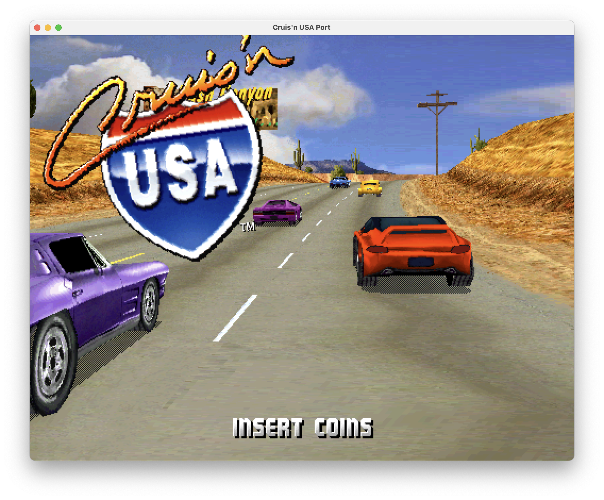

# Cruis'n USA

A work-in-progress port of the original [Cruis'n USA](https://en.wikipedia.org/wiki/Cruis%27n_USA) arcade game from
[TMS320C30](https://en.wikipedia.org/wiki/TMS320) assembly to portable C using SDL2.

The goal is **100% functional equivalence with the version 4.5 arcade ROM** on
modern systems.

<p align="center">
  
</p>

## Status

The port currently plays the attract sequence shown above. It is under active
development and is not yet fully playable.

## Background

The original assembly source was published by
[Historical Source](https://github.com/historicalsource/cruisin-usa) and is
preserved in [`asm/`](asm/). That source is **version 4.4**, while this project
targets the later **version 4.5** retail ROM.

To recover the changes made between those versions, this project uses a
[source ↔ ROM disassembly walker](tools/ida/walk_source_and_rom.py). It aligns
the 4.4 source with the disassembled 4.5 program, allowing the code and data
that actually shipped to be identified and restored.

- [4.4 to 4.5 changes](https://github.com/jeff-1amstudios/cruisin-usa/commit/2033b4e68533fe9055101752713465132aad751e)

## Asset recovery
The original archive also omits game assets and their final IDs and
memory locations. The ROM walker recovers these from matched instructions. For
example:
1. We start with asm code that references an unknown value. [(link)](https://github.com/jeff-1amstudios/cruisin-usa/blob/643868980449fae3f40b2cad4e4422eebe4e9343/asm/BONUS.ASM#L665)
```
...
CALL  KILL_THE_REANIMATORS		;cheering crowd
LDL	  shared_PALETTES,AR2
CALL  dealloc_section
...
```

2. The walker matches that code to `0x00003AF4` in the 4.5 ROM so now we have
```
CODE:00003AF4    LDL	shared_PALETTES,AR2
```
3. At `00003AF4`, the disassembly shows us that the value being set on AR2 is a pointer to `0x0000A16A` so we know that `shared_PALETTES` should be defined as a pointer to `0x0000A16A` in the ROM and can now reference it in our ported C code.

The same process recovers asset IDs, palette numbers, function addresses, memory locations, and other missing constants.

## Workflow

AI is used to translate the game function by function, keeping the original
assembly beside the generated C for review and debugging.

Correctness is the key challenge on a project like this. Its "easy(!?)" enough to generate reasonable looking code, but much harder to know if it is really correct or not.

In other c-based decomp projects, assembly-level correctness can be used, like https://github.com/dethrace-labs/dethrace or https://github.com/isledecomp/isle. Here, that is not possible as the original code is written in TMS320C assembly, not c.

Instead, this project uses **MAME** running version 4.5 as the source of truth and checks behavior against it at runtime.
Assertion markers capture function entries, registers, and memory from MAME;
the port then replays the same sequence and stops at the first difference. See
the [translation guide](docs/function-translation.md) and
[debugging guide](docs/debugging.md) for details.

This enables us to run a tight loop of 
- writing code
- asserting its behavior
- observing differences vs MAME
- patching
- re-observing and repeat until it all matches.

## Building

Dependencies:

- CMake 3.20+
- SDL2
- libcurl 7.68+ (native downloads)
- A C11 compiler
- Python 3

ZIP support is provided by the vendored [miniz 3.1.2](lib/miniz/UPSTREAM.md);
no system zlib installation is required.

DCS sound-board emulation uses the vendored
[ADSP-21xx interpreter](lib/adsp2100/README.md), originally written by Aaron
Giles for MAME and distributed under the
[BSD 3-Clause license](lib/adsp2100/LICENSE). It replaces the previously
vendored DCSExplorer decoder.

```sh
cmake -S . -B build
cmake --build build
```

Every push and pull request builds macOS, Linux, and Windows artifacts;
a failed build or packaging step fails the corresponding check. Publishing a
GitHub release attaches all three packages to the release after they build. You
can also run the **Build release artifacts** workflow manually. These use
CMake's `RelWithDebInfo` mode:
the universal macOS DMG contains an application bundle and matching `.dSYM`,
the Linux `.tar.gz` contains a `.debug` file, and the Windows ZIP retains DWARF
debug symbols in the executable. Packages use names such as
`crusn-VERSION-macos-arm64-x64.dmg`, include SDL2, and omit game ROMs. Run the
executable from a directory containing `roms/crusnusa.zip`.

To check translated C3x floating-point operations:

```sh
cmake --build build --target check-c3x-translation
```

## Running

This project does not include arcade ROMs or missing game assets. Supply a
legally obtained version 4.5 MAME ROM set at:

```text
roms/crusnusa.zip
```

Run the game from the repository root. Free play is enabled by default and MAME
validation is disabled:

```sh
./build/crusn
```

The game starts fullscreen by default. Use `--window` to run it in a resizable
window. Add `--widescreen` for an optional 712×400 view that reveals extra scenery
on both sides and keeps the original UI centered. Original mode remains the
default; MAME validation uses original mode. See [widescreen details](docs/widescreen.md).
Use `--no-free-play` to use the normal coin settings, and `--no-sound` to run
without initializing or playing audio. `--girls` and `--no-girls` override the
corresponding cabinet adjustment. For debugging, `--race-time SECONDS`
overrides the normal race countdown in five-second steps. Press <kbd>Return</kbd>
for Start.

## Browser build

[Play the web version](https://jeff-1amstudios.github.io/cruisin-usa/).
Every push builds the web port; successful web builds on `main` deploy
automatically to GitHub Pages.


The Emscripten build compiles the same translated C/C++ to WebAssembly and uses
SDL2's OpenGL ES renderer through WebGL. Install and activate Emscripten 4.0.19
(the version used in CI), then run:

```sh
emcmake cmake -S . -B build-web -DCMAKE_BUILD_TYPE=Release -DCRUSN_TRACE=OFF
cmake --build build-web --parallel
python3 -m http.server 8000 --directory build-web
```

Open `http://localhost:8000/crusn.html`. Select a local ROM ZIP or press Start
to download it. The default download URL is
`https://archive.org/download/crusnusa/crusnusa.zip`. Override it at build time with
`-DCRUSN_ROM_URL=https://your-server/crusnusa.zip`, or override it in the browser
with `?rom-url=https%3A%2F%2Fyour-server%2Fcrusnusa.zip`. Cross-origin downloads
require the ROM server to allow CORS. HTTPS pages must use HTTPS download URLs.

Both native and browser builds show the same embedded-font progress/error UI
before starting the game. Downloads and local imports are validated before
replacing the cached ROM. Browser ROMs are cached in IndexedDB; native ROMs use
`roms/crusnusa.zip` in the working directory. Native builds also accept
`--rom-url URL` or the `CRUSN_ROM_URL` environment variable. An empty URL disables
automatic downloading. Drop a local ZIP onto the native startup window to import
it, and press R to retry a failed download.

Deploy `crusn.html`, `crusn.js`, and `crusn.wasm` together on a static HTTP(S)
server that serves `.wasm` as `application/wasm`. No ROM data is bundled.
Boot/loading screens are skipped in the web build. If the browser suspends
sound, use Enable sound or interact with the canvas. Keyboard controls are
supported; touch controls and gamepads are not implemented yet.

See [web port details](docs/web-port.md) for architecture and verification.

## Contributing

Correctness takes priority over cleanup. Keep translations close to the
original assembly and validate behavior against MAME wherever practical. Start
with the [function translation guide](docs/function-translation.md); coroutine
style `PROC` routines also have a [dedicated guide](docs/proc-translation.md).

## Legal

*Cruis'n USA* and its original code and assets belong to their respective
rights holders. This is an independent preservation and compatibility project
and is not affiliated with or endorsed by the original developers or
publishers. No commercial ROM data is included.
